# External 02 · Admin Portal Guide

| | |
|---|---|
| **Audience** | EXTERNAL – shop owner and staff (no technical knowledge needed) |
| **Version** | 2.0 · October 2026 |
| **About the pictures** | The screens below use **sample data**. Your portal looks the same with your own products and orders. |

**Open the portal:** `https://www.your-domain.in/admin` · Use a laptop or tablet for the best view.

---

## 1 · Signing in
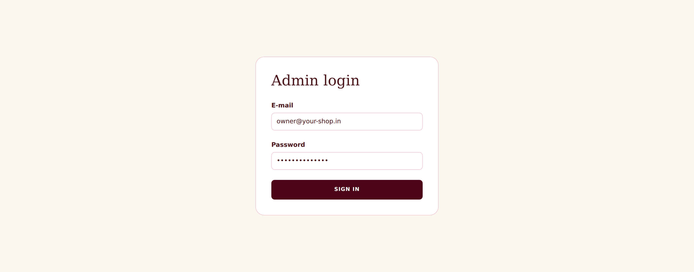
1. Enter your **e-mail** and **password** (given to you by your developer).
2. Click **Sign in**. You are signed out automatically after **8 hours**.
3. After **8 wrong attempts** you must wait 15 minutes.

| Role | Can do |
|---|---|
| **Owner** | everything: products, stock, orders, **refunds**, coupons, customers & offers, **reports & profit**, expenses, activity log |
| **Staff** | orders, shipments, returns (approve/reject), products, stock, inventory, messages – **no** money reports, refunds, coupons, customer list |

## 2 · The menu
`Dashboard · Orders · Returns · Products · Inventory · Coupons · Customers · Reports · Expenses · Messages · Activity log` (owner-only items are hidden for staff).

## 3 · Dashboard (your daily view)

* **Orders to ship** – paid or COD orders not yet booked with the courier. Aim for **0** each evening.
* **Return requests** – customers waiting for your decision.
* **Low stock sizes** – sizes about to run out.
* **Messages failed** – customer e-mails/SMS that could not be sent (should be 0).
* **Today / This month / This year** – sales and profit (owner only).
Full explanation: [Dashboard & Reports Guide](External_03_Admin_Dashboard_and_Reports_Guide.md).

## 4 · Orders
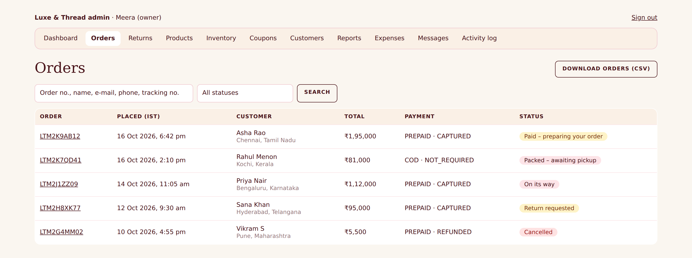
Search by order number (starts with **LT**), customer name, e-mail, phone or tracking number; filter by status.

| Status | Meaning | Your action |
|---|---|---|
| Awaiting payment | customer is still paying | none – released automatically after 30 minutes |
| Paid / Confirmed (COD) | ready to ship | open the order → **Create shipment** (it normally happens by itself) |
| Packed – awaiting pickup | booked with Shiprocket | pack and hand over to the courier |
| On its way / Delivered | tracking updates by itself | none |
| Return requested | customer wants to return | see *Returns* |
| Cancelled / Returned | closed | refund done automatically for online payments |

### Opening an order
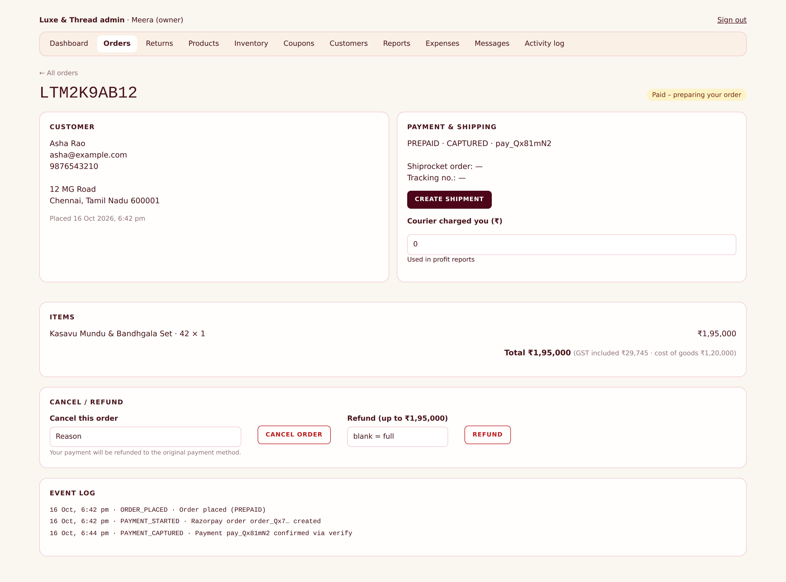
* **Create shipment** – sends the order to Shiprocket (use again as **retry** if a red error box appears; read the message).
* **Sync tracking** – fetches the latest courier status.
* **Courier charged you (₹)** – type what the courier billed; it feeds the profit report.
* **Cancel order** – gives a reason; stock goes back, the coupon is released, online payments are **refunded automatically**, the customer is e-mailed.
* **Refund** (owner) – refund all or part of an online payment.
* **Event log** – the diary of everything that happened to the order.

## 5 · Products — add, price, discount, hide
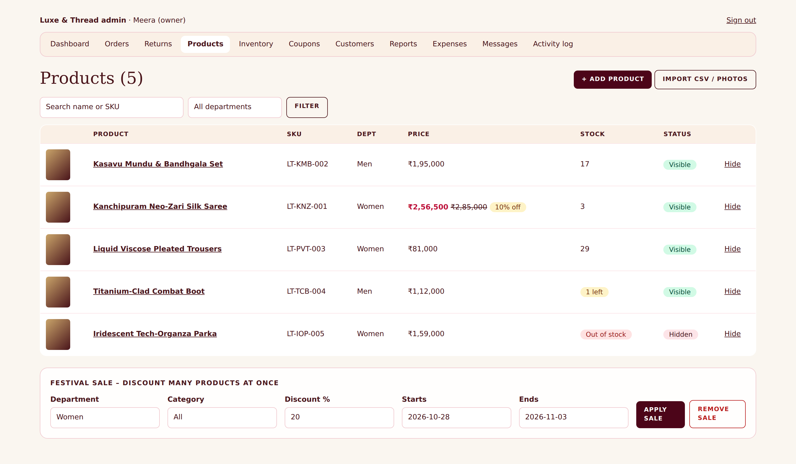
The list shows photo, name, SKU (style code), price (with sale price struck through), stock and visibility. **Hide/Show** removes or restores a product in the shop instantly.

### 5.1 How to add a new product
1. **Products → + Add product**.
2. Type a **SKU** – a short code of your own, like `LT-KMB-002` (never change it later).
3. Fill name, category, department (Women/Men/Kids), size type, **MRP**, **selling price (incl. GST)**, **cost price** (what it costs you), GST % and weight.
4. In **Sizes and starting stock** write for example `S:10;M:12;L:8` (size, colon, quantity; separate with semicolons).
5. **Create product**, then add **photos** (JPG/PNG/WebP, up to 3 MB; the first photo is the main one).

### 5.2 How to add stock (new delivery from your supplier)
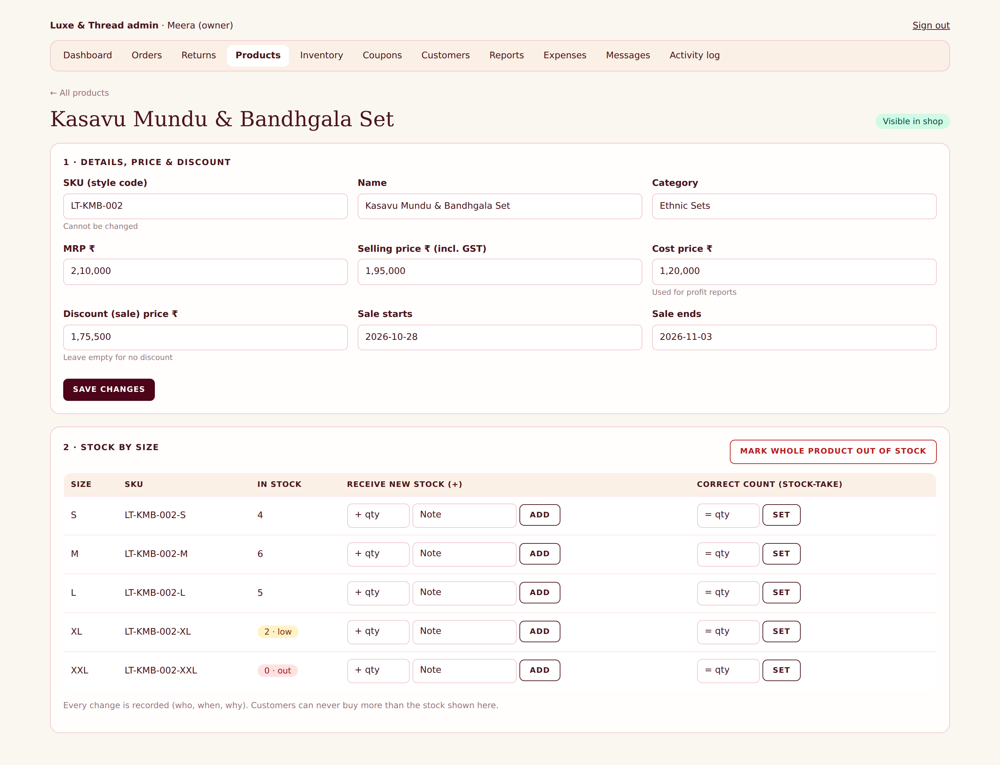
1. Open the product → **2 · Stock by size**.
2. In the row of the size, type the quantity under **Receive new stock (+)**, optionally a note, click **Add**. The number is **added** to what you have.
3. Wrong count? Use **Correct count (stock-take)** → type the real number → **Set**.
Every change is recorded in a diary (who, when, why).

### 5.3 How to adjust the price
Open the product → **1 · Details, price & discount** → change **MRP / Selling price / Cost price** → **Save changes**. New orders use the new price immediately; old orders keep the price the customer paid.

### 5.4 How to give a discount on one product
Same screen: enter **Discount (sale) price ₹**, and optionally **Sale starts / Sale ends** dates → **Save changes**. The shop shows the old price struck through and "x % off". The discount switches on and off by itself on the dates.

### 5.5 How to run a festival sale on many products
Products → scroll to **Festival sale**: choose department and/or category, type the discount **%**, pick dates → **Apply sale**. To end it early press **Remove sale**.

### 5.6 How to mark a product out of stock
Open the product → **Mark whole product out of stock** (sets every size to 0). To sell again, add stock (5.2). To hide the product completely use **Hide from shop**.

## 6 · Importing many products (new arrivals)
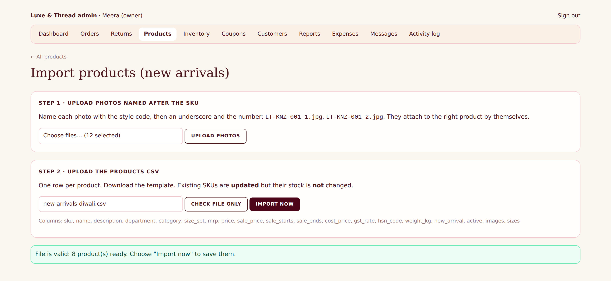
1. **Products → Import CSV / photos**.
2. Name each photo after the style code: `LT-KNZ-001_1.jpg`, `LT-KNZ-001_2.jpg` → **Upload photos** (they attach by themselves).
3. **Download the template**, fill one row per product in Excel/Google Sheets, save as CSV.
4. Upload it → **Check file only**. If a line is wrong you get the line number and the reason. Fix and upload again.
5. **Import now**. Existing SKUs are **updated** (price, text, discount…) but their **stock is not changed**.

## 7 · Inventory

See what needs attention (out of stock, low stock), stock value, and download the stock report. **Refill many sizes at once:** download the stock template, list `variant_sku, add_qty, note`, upload → **Check file only** → **Add to stock**.

## 8 · Coupons (owner)
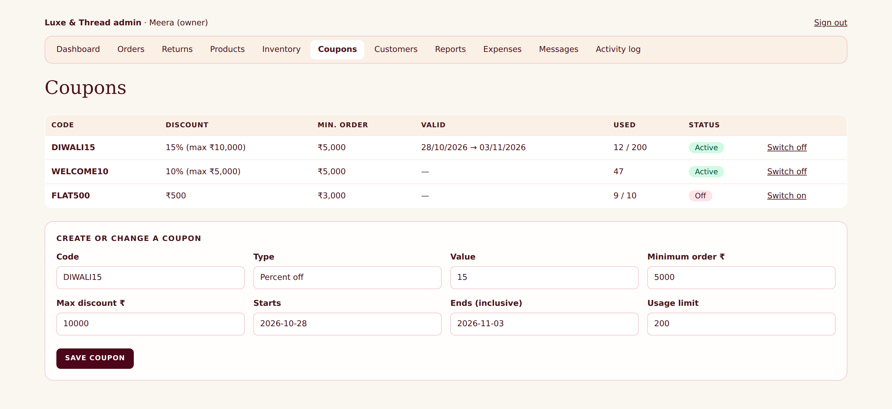
Create codes like `DIWALI15`: percent or flat amount, minimum order, maximum discount, dates and total uses. Customers type the code in their bag. **Switch off** stops a code immediately.

## 9 · Returns
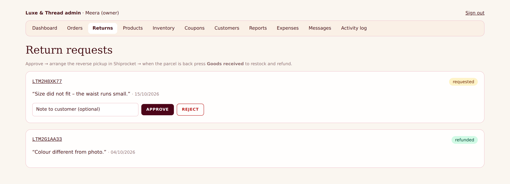
Customers can request a return within **7 days** of delivery. **Approve** (they are e-mailed) → arrange the pickup in your Shiprocket panel → when the parcel is back press **Goods received → refund** (owner): stock returns and the refund is sent. **Reject** with a note if it does not qualify.

## 10 · Customers and offers (owner)
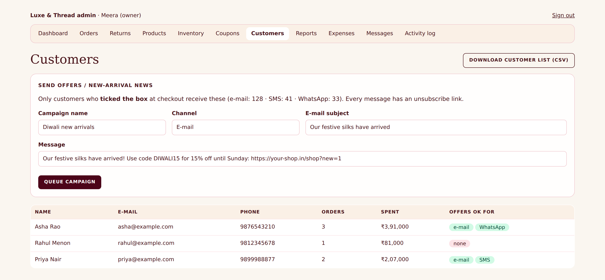
Customers are saved when they order. Only those who **ticked** "send me offers" (e-mail / SMS / WhatsApp) receive your campaigns, and every message has an unsubscribe link. Write the message → **Queue campaign**. SMS and WhatsApp need provider approvals first (your developer will tell you when they are on).

## 11 · Messages sent to customers
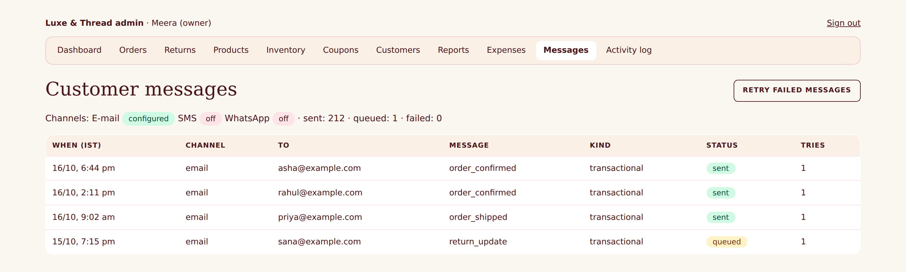
Shows every e-mail/SMS/WhatsApp: **sent**, **queued** (waiting), **failed** (with the reason). Press **Retry failed messages** after the problem is fixed.

## 12 · Expenses (owner)
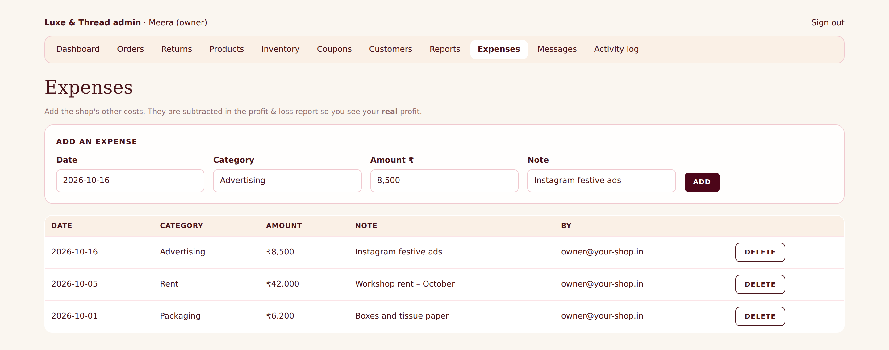
Add rent, salaries, advertising, packaging, software. They are subtracted in the profit report so you see your **real** profit.

## 13 · Reports (owner)

See [Dashboard & Reports Guide](External_03_Admin_Dashboard_and_Reports_Guide.md).

## 14 · Good habits
* Check the **Dashboard every morning**; ship what is waiting.
* Enter **cost price** for every product and the **courier charge** on each order – profit is only as good as these numbers.
* Do a **stock-take** monthly and use *Set* to correct differences.
* Never share your password; ask your developer to create a login for each staff member.
* Cancel/refund from the portal (not only in Razorpay/Shiprocket) so everything stays in sync.

## 15 · Need help?
Quote the **order number** and what you clicked. If you see a red message, send a screenshot to your developer. Common problems: [Troubleshooting for support staff](../internal/Internal_05_Troubleshooting_Application.md).
