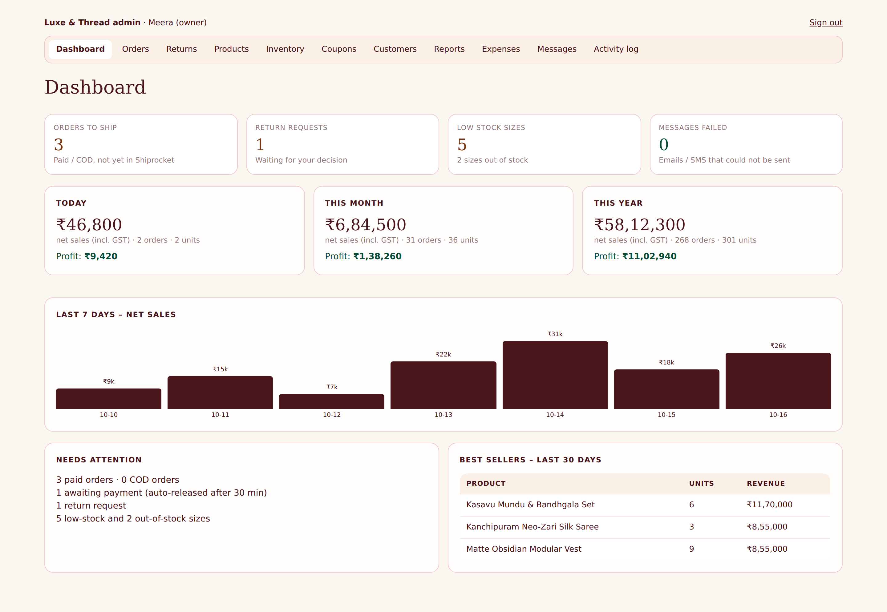
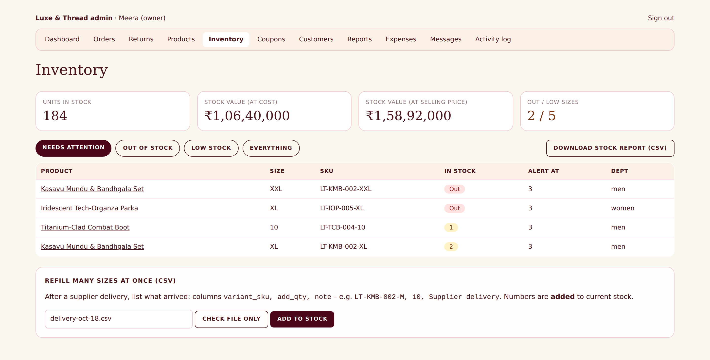
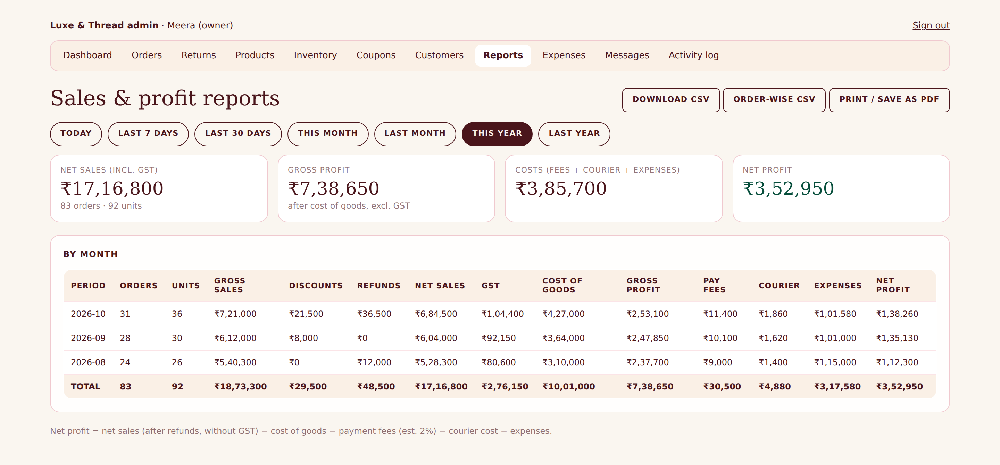

# External 03 · Admin Dashboard & Reports Guide

| | |
|---|---|
| **Audience** | EXTERNAL – shop owner (reports are owner-only) |
| **Version** | 2.0 · October 2026 |

## 1 · The dashboard

| Card / panel | What it tells you | What to do |
|---|---|---|
| **Orders to ship** | Paid or COD orders not yet booked with the courier | open each, **Create shipment** |
| **Return requests** | customers waiting for your answer | Returns → approve / reject |
| **Low stock sizes / out of stock** | sizes at or below their alert level | reorder; add stock when it arrives |
| **Messages failed** | customer messages that could not be sent | Messages → Retry |
| **Today / This month / This year** | net sales (after refunds, incl. GST), orders, units, and **profit or loss** | compare with your target |
| **Last 7 days** | bar chart of net sales per day | spot slow days |
| **Best sellers (30 days)** | top products by revenue | reorder winners |
| **Low stock** | the 8 sizes closest to selling out | restock |

## 2 · Stock: in stock and out of stock

**Inventory** lists every size that is **out of stock** or **low**, shows **units in stock** and the **value of your stock** (at cost and at selling price), and has a download button for the full stock report.
* *Low* = at or below the size's alert level (default 3).
* **Out of stock** sizes appear greyed and cannot be bought by customers.

## 3 · Sales & profit reports

### 3.1 Choosing the period
Click a preset: **Today · Last 7 days · Last 30 days · This month · Last month · This year · Last year**, or pick **From / To** dates and press **Show**. **Group by** day, month or year gives the daily, monthly and yearly views. All dates use **Indian time** (a 11:30 pm order counts for that day).

### 3.2 What each column means
| Column | Meaning |
|---|---|
| Orders / Units sold | number of orders and pieces |
| **Gross sales** | what customers paid (incl. GST) |
| Coupon discounts | discounts you gave through coupon codes |
| **Refunds / returns** | money returned (cancellations after payment, returns, returned-to-origin) |
| **Net sales** | gross sales − refunds |
| GST included | tax portion of net sales – belongs to the government, not profit |
| **Net sales (excl. GST)** | your real revenue |
| **Cost of goods** | cost price × units sold (returned goods are not counted) |
| **Gross profit** | revenue − cost of goods |
| Payment fees (est.) | estimated gateway cost (default 2 % of online payments) |
| Courier cost | what you typed on each order as the courier's charge |
| Other expenses | from the **Expenses** page |
| **Net profit / (loss)** | gross profit − fees − courier − expenses. **Negative = loss** |

### 3.3 Worked example (one order)
Customer pays **₹1,180** (incl. 18 % GST), product cost **₹400**, paid online, courier charged **₹60**.
GST = 1,180 − 1,180/1.18 = **₹180** → revenue excl. GST **₹1,000** → gross profit **₹600** → fees 2 % of 1,180 = **₹23.6** → net profit = 600 − 23.6 − 60 = **₹516.4** (before shop expenses).

### 3.4 Downloads
| Button | File | Use |
|---|---|---|
| **Download CSV** | profit & loss table for the chosen period | accountant, Excel |
| **Order-wise CSV** | one row per order with GST, cost, courier, refund | detailed checks |
| **Print / Save as PDF** | the report page, print-friendly | share or archive (choose "Save as PDF" in the print window) |
| Inventory → *Download stock report* | every size, stock, value | stock-taking |
| Orders → *Download orders* | order list | reconciliation |
| Customers → *Download customer list* | customers and consent | marketing (owner) |
CSV files open in Excel and Google Sheets.

## 4 · How to make the numbers trustworthy
1. Enter **cost price** on every product (otherwise profit looks too high).
2. Enter the **courier charge** on orders (Shiprocket billing shows it).
3. Add **expenses** (rent, ads, salaries, packaging) – monthly is enough.
4. Confirm **GST rates** with your CA.
5. Check the **payment fee %** with your Razorpay plan (your developer can change it).
Profit here is a **management estimate** to guide decisions – your CA's books are the official figures.

## 5 · Suggested routines
| When | What |
|---|---|
| Daily (5 min) | Dashboard: orders to ship, returns, low stock, failed messages |
| Weekly | Reports → *Last 7 days* (group by day); best sellers; reorder low stock |
| Monthly | Reports → *Last month* (group by day) + *This year* (group by month); add expenses; download CSV for your CA; stock-take |
| Yearly | Reports → *Last year* (group by month); download all CSVs for tax time |
