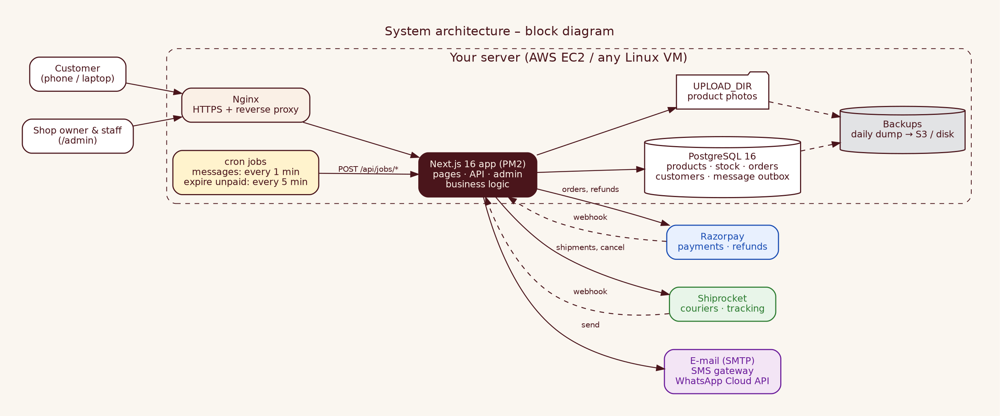
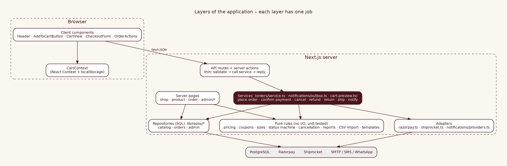
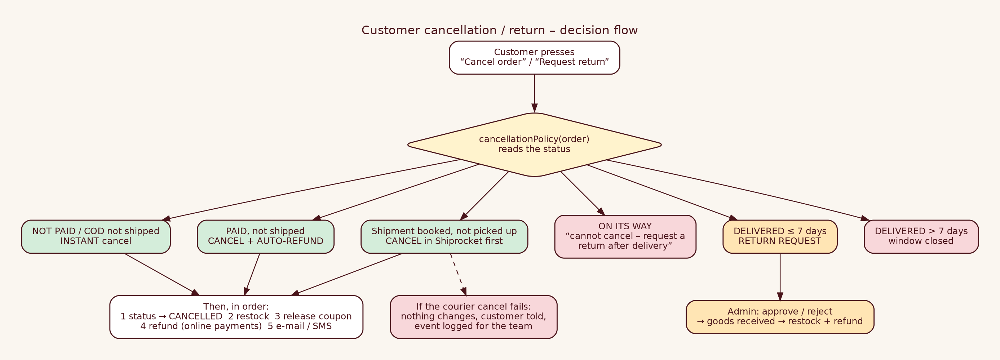
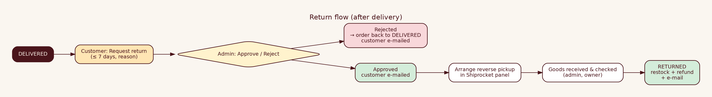
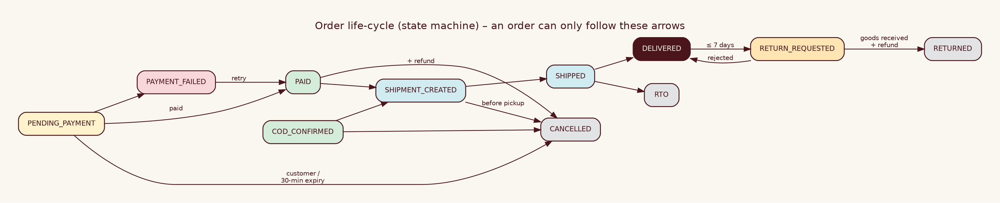
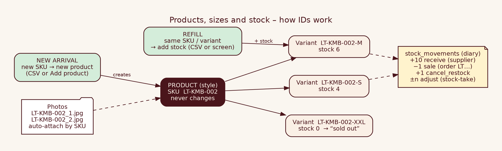

# Internal 02 · Low-Level Design (LLD)

| | |
|---|---|
| **Audience** | INTERNAL – developers |
| **Scope** | Full architecture, block diagrams, flow charts, component interaction, tools & versions and *why* |
| **Version** | 2.0 · October 2026 |

> **How to read this (beginners):** Part 1–2 give the map, Part 3 explains the tools, Part 4 follows real requests through the code, Part 5 is a lookup table of files. Keep the project open in VS Code (`Ctrl+P` jumps to a file).

---

## 1 · Architecture

### 1.1 Block diagram


All business code is **one Next.js application**. It talks to four outside things: **PostgreSQL** (data), **Razorpay** (money), **Shiprocket** (couriers) and **message channels** (e-mail/SMS/WhatsApp). Two cron jobs call the app to send queued messages and release unpaid orders. Nginx terminates HTTPS.

### 1.2 Layers


| Layer | Job | Rule of thumb |
|---|---|---|
| Client components | Clicks, forms, bag | Never decide prices or stock |
| Server pages | Render data from the database | Read-only |
| API routes / server actions | Validate input, call a service, answer | Thin – no business rules |
| Services | "What does *place order* mean?" – orchestrate | The only layer that combines DB + providers |
| Pure rules | Pricing, coupons, sizes, statuses, reports, CSV, templates | **No I/O** → unit-testable in milliseconds |
| Repositories | SQL | The only place with SQL |
| Adapters | Razorpay, Shiprocket, SMTP/SMS/WhatsApp | The only place that knows provider URLs |

**Why this split?** You can test the rules without a database, swap a provider by touching one adapter, and reason about money flows in one file (`orders/service.ts`).

## 2 · Next.js 16 specifics that affect the code
| Feature | What it means here |
|---|---|
| **Cache Components** (`cacheComponents: true`) | Pages pre-build a static shell; anything reading the **database, cookies or URL** must sit inside `<Suspense>` and the page exports `export const instant = false`. All catalogue/admin pages follow this. |
| `params` / `searchParams` are **Promises** | Always `await` them (inside the Suspense child). |
| No clock/random in server pages | `new Date()` in a *pre-built* part breaks the build; we only use it after awaiting data, or in API routes/actions. |
| `after()` | Runs work **after** the HTTP reply (shipment creation, sending messages) so customers never wait. |
| Server actions | Admin forms post directly to functions in `app/admin/actions.ts`; each calls `requireAdmin()` itself. |
Read `AGENTS.md` and `node_modules/next/dist/docs/` before changing routing/caching code.

## 3 · Tools, versions and why
| Tool | Version | Why this tool |
|---|---|---|
| Node.js | **22 LTS** (≥ 22) | Long-term support; required by Next 16; built-in test runner |
| Next.js | **16.4.1** (App Router, Turbopack) | One codebase for pages + API; server rendering = fast + SEO |
| React | **19.3** | Required by Next 16; server/client components |
| TypeScript | **5.9** (strict) | Catches mistakes while typing; types document data |
| Tailwind CSS | **4.x** (CSS-first tokens) | Consistent design with small utility classes; brand tokens `bg-sandalwood`, `text-maroon` |
| Zod | **4.6** | One validation schema for browser *and* server |
| PostgreSQL | **16** | Open source, ACID transactions, constraints, `FOR UPDATE SKIP LOCKED`, JSONB; the standard choice |
| `pg` | **^8** | Mature driver with a connection pool |
| Nodemailer | **^6** | SMTP e-mail with any provider; MIT-0 |
| Razorpay | REST API (no SDK) | We need only *create order*, *refund*, *verify HMAC* – a few lines of `fetch` + `crypto` |
| Shiprocket | REST API v1 | Many couriers via one account |
| Nginx | 1.24+ | HTTPS, buffering, static caching |
| PM2 | 5.x | Restart on crash/reboot, logs |
| Playwright | ^1.49 | Real-browser tests, desktop + mobile |
| k6 | latest | Load tests as code |
| ESLint | 9 + `eslint-config-next` | Static bug finding |
| Graphviz / Chromium | – | Diagrams / PDF export for these docs |

## 4 · Request flows

### 4.1 Browse → bag (prices are never trusted)
```
Browser  GET /shop?department=women&size=M&price=2000-10000
Server   shop/page.tsx → Suspense → listProducts(filter) → SQL (effective price = sale or normal)
Browser  adds to bag → localStorage {product snapshot, size, qty}   (display only)
Browser  POST /api/cart/price {items, couponCode}  →  previewCart()
Server   getProductsByIds → priceCart() (pure) → {lines, totals, problems}
```
`priceCart` rules: product active · size exists · stock ≥ qty (also across duplicate lines) · price = sale price while the window is open · coupon via `evaluateCoupon` · discount spread **proportionally** over lines (last line gets rounding remainder) · GST included = Σ `line − line/(1+rate)` on the **discounted** amount · cost of goods snapshot.

### 4.2 Checkout and payment


`placeOrder()` (`orders/service.ts`):
1. Load products, coupon → `priceCart` (throws `VALIDATION_ERROR` / 409 with a customer-safe message).
2. COD rules (`COD_ENABLED`, `COD_MAX_ORDER_VALUE`).
3. **PREPAID:** create the Razorpay order **first** (if it fails nothing is saved or reserved; an unused Razorpay order is harmless).
4. **One DB transaction:** upsert customer (consent flags only ever switch **on**) → count coupon (`UPDATE … WHERE used_count < usage_limit`) → insert order, items, first event → **reserve stock** (`UPDATE product_variants SET stock = stock − n WHERE id = $1 AND stock >= n`, zero rows ⇒ "just sold out" ⇒ whole transaction rolls back).
5. COD: queue "order confirmed" message, shipment via `after()`.

Why *Razorpay first, DB second*: no compensation logic needed – the only thing that can be left over is an unpaid Razorpay order.

### 4.3 Payment confirmation (idempotent)
`confirmPrepaidPayment()` is called by **verify** *and* by the **Razorpay webhook**. It: finds the order by `razorpay_order_id` → returns early if already captured/refunded → in one locked update sets `CAPTURED`, `PAID` (state machine) → counts the customer's stats → queues the confirmation message. If the order was **already cancelled/expired**, it records `LATE_PAYMENT` and **refunds automatically**.

### 4.4 Shipping
`createShipment()` → Shiprocket *create order* → save ids + status `SHIPMENT_CREATED` → *best effort* `assign/awb` + `generate/pickup`. Errors are stored (`shipment_last_error`) and the owner retries from the order page. Shiprocket webhooks (`/api/webhooks/courier-updates`, token in `x-api-key`) → `applyCourierStatus()` → status change, `delivered_at`, messages, RTO restock.

### 4.5 Cancellation and returns


Details: [Internal 13](Internal_13_Order_Cancellation_and_Returns_Design.md).

### 4.6 Notifications

Details: [Internal 12](Internal_12_Notifications_and_Marketing_Design.md).

### 4.7 Order state machine


### 4.8 Stock & product identity


### 4.9 Background jobs (cron → HTTP)
| Job | Endpoint | Schedule | What it does |
|---|---|---|---|
| Send messages | `POST /api/jobs/notifications` | every minute | `processOutbox(50)` – send due messages, retry failures |
| Release unpaid orders | `POST /api/jobs/expire-orders` | every 5 minutes | cancel `PENDING_PAYMENT` older than 30 min, restock, release coupon |
Both need header `x-jobs-secret: $JOBS_SECRET`.

## 5 · Module catalogue
| Path | Responsibility |
|---|---|
| `app/page.tsx`, `shop/`, `products/[slug]/`, `size-guide/`, `about/`, `contact/`, `policies/[slug]/` | Public storefront |
| `app/cart`, `checkout`, `order/[id]` | Bag, checkout, customer order page (+ `OrderActions` cancel/return) |
| `app/admin/**` | Owner portal: dashboard, products (+import), inventory, orders, returns, coupons, customers, reports, expenses, messages, audit; `actions.ts` (all mutations); `download/[report]` (CSV) |
| `app/api/**` | `health`, `cart/price`, `shipping/serviceability`, `checkout/{create,verify}`, `orders/cancel`, `webhooks/{razorpay,courier-updates}`, `jobs/{notifications,expire-orders}` |
| `app/media/[...path]` | Serves uploaded photos from `UPLOAD_DIR` (safe names only) |
| `lib/pricing.ts`, `coupons.ts`, `sizes.ts`, `cancellation.ts`, `reports.ts`, `dates.ts`, `csv.ts`, `catalog-import.ts`, `media.ts` | **Pure rules** (tested) |
| `lib/orders/service.ts`, `status.ts` | Money-moving orchestration; state machine |
| `lib/repos/{catalog,orders,admin}.ts`, `db.ts` | SQL and connection pool/transactions |
| `lib/razorpay.ts`, `shiprocket.ts`, `notifications/*` | Provider adapters, templates, outbox |
| `lib/env.ts`, `errors.ts`, `http.ts`, `logger.ts`, `rate-limit.ts`, `admin-auth.ts`, `admin-session.ts`, `password.ts` | Platform: config, errors, wrapper, logs, limits, auth |
| `db/migrations`, `db/seed`, `scripts/` | Schema, demo data, `migrate`, `create-admin`, screenshot capture |
| `tests/` | integration, e2e, load |

## 6 · Component interaction
| From → To | Protocol | Auth | Timeout / retry |
|---|---|---|---|
| Browser → app | HTTPS JSON / form posts | none (public) / signed cookie (admin) | – |
| App → PostgreSQL | TCP, `pg` pool (max 10) | `DATABASE_URL` | connect 5 s; transactions all-or-nothing |
| App → Razorpay | HTTPS REST, Basic auth | key id + secret | 10–15 s; no auto-retry (user retries); idempotent confirm |
| Razorpay → app | HTTPS webhook | HMAC-SHA256 of raw body | Razorpay retries; we answer 200 fast |
| App → Shiprocket | HTTPS REST, Bearer token | API-user login (token cached ≤ 8 days, 1 re-login on 401) | 10–15 s; admin retry |
| Shiprocket → app | HTTPS webhook | `x-api-key` token | answer 200 |
| App → SMTP/SMS/WhatsApp | SMTP / HTTPS | credentials in env | outbox retry 2,4,8,16 min (5 tries) |
| cron → app | HTTPS POST | `x-jobs-secret` | next tick |

## 7 · Error handling, security, configuration
* Errors: [Internal 16](Internal_16_Error_Handling.md). Security: [Internal 14](Internal_14_Security_and_Compliance.md). Settings: [Internal 04](Internal_04_Razorpay_Shiprocket_Config_Guide.md).
* **Idempotency map:** payment confirm (status check), refund (remaining-amount check), restock (once per order: movement lookup), coupon release, shipment creation (existing Shiprocket id), outbox claim (`SKIP LOCKED`).

## 8 · Known limits
In-memory rate limiter (per server) · single-server hosting · full-text search is `ILIKE` · reports aggregate in application code (fine to tens of thousands of orders; move to SQL `GROUP BY` beyond that) · Shiprocket return *creation* is manual in its panel.
