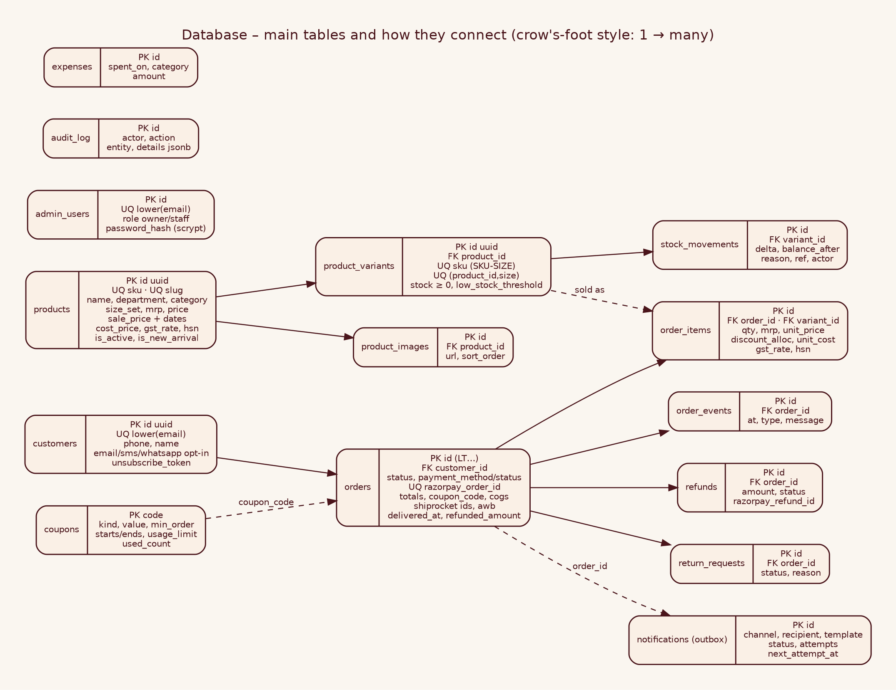

# Internal 03 · Database Design (PostgreSQL 16)

| | |
|---|---|
| **Audience** | INTERNAL – developers, DBAs |
| **Source of truth** | `db/migrations/001_init.sql` (run with `npm run db:migrate`) |
| **Version** | 2.0 · October 2026 |

## 1 · Conventions
* Names are `snake_case`; money is `numeric(12,2)` **INR**; time is `timestamptz` (UTC) – reports convert to **IST**.
* **PK** primary key · **FK** foreign key · **UQ** unique · **CK** check rule · **IDX** index.
* The database itself enforces key rules (negative stock, bad status, duplicate SKU) so that a bug in code cannot corrupt data.



## 2 · Catalogue
### `products` – one row per style
| Column | Type | Key / rule | Description | Example |
|---|---|---|---|---|
| id | uuid | **PK** (auto) | internal id | `9c1f…` |
| sku | text | **UQ** | style code – never changes | `LT-KMB-002` |
| slug | text | **UQ** | URL part | `kasavu-mundu-and-bandhgala-set` |
| name / description | text | | shown to customers | |
| department | text | CK women/men/kids/unisex | main navigation | `men` |
| category | text | | filter chip | `Ethnic Sets` |
| size_set | text | CK apparel/kids/footwear/free | which sizes are allowed | `apparel` |
| mrp / price | numeric | CK ≥ 0 | printed price / selling price (GST-incl.) | 210000 / 195000 |
| sale_price, sale_starts_at, sale_ends_at | numeric, timestamptz | | discount window (optional) | 175500, 28 Oct–3 Nov |
| cost_price | numeric | CK ≥ 0 | your cost, for profit | 120000 |
| gst_rate, hsn_code | numeric, text | CK 0–40 | tax data (confirm with CA) | 18, 6203 |
| weight_kg | numeric | CK > 0 | courier weight | 1.4 |
| is_active, is_new_arrival | boolean | | visible / "New" badge | true |
**IDX** `(department, category) WHERE is_active`.

### `product_variants` – one row per size
| Column | Type | Key / rule | Description | Example |
|---|---|---|---|---|
| id | uuid | **PK** | | |
| product_id | uuid | **FK** → products (cascade) | | |
| size | text | **UQ** with product_id | allowed by size_set | `M` |
| sku | text | **UQ** | `STYLE-SIZE` | `LT-KMB-002-M` |
| stock | int | **CK ≥ 0** | pieces available | 6 |
| low_stock_threshold | int | | alert level | 3 |

### `product_images`
`id` PK · `product_id` FK · `url` (`/media/LT-KMB-002_1_ab12cd34.jpg` or `/images/…`) · `alt` · `sort_order` (0 = main).

### `stock_movements` – the stock diary
| Column | Type | Description | Example |
|---|---|---|---|
| id | bigserial PK | | |
| variant_id | uuid FK | which size | |
| delta | int | + added / − removed | −1 |
| balance_after | int | stock after the change | 5 |
| reason | text CK | `receive` `adjust` `sale` `cancel_restock` `return_restock` `import` `initial` | `sale` |
| ref | text | order id / import | `LTM2K9AB12` |
| note, actor | text | why / who (admin e-mail or `system`) | |
**IDX** `(variant_id, created_at DESC)`. Rule: *current stock = sum of deltas*; `balance_after` lets you audit any day.

### `coupons`
`code` **PK** (UPPERCASE) · `kind` CK percent/flat · `value` · `min_order` · `max_discount` · `starts_at/ends_at` · `usage_limit` · `used_count` · `is_active`. Example: `DIWALI15, percent, 15, 5000, 10000, …, 200, 12, true`.

## 3 · Customers & staff
### `customers`
| Column | Description | Example |
|---|---|---|
| id uuid PK | | |
| email | **UQ on lower(email)** | `asha@example.com` |
| phone, name | | `9876543210` |
| email_opt_in, sms_opt_in, whatsapp_opt_in | consent per channel, **default false** | true / false / true |
| consent_updated_at | when consent last changed | |
| unsubscribe_token | **UQ** random; used in unsubscribe links | |
| orders_count, total_spent, last_order_at | lifetime stats | 3, 391000 |

### `admin_users`
`id` PK · `email` UQ(lower) · `name` · `role` CK owner/staff · `password_hash` (`scrypt$N$salt$hash`) · `is_active` · `last_login_at`. Create with `npm run admin:create`.

### `audit_log`
`id` · `at` · `actor` · `action` (`product_update`, `stock_add`, `refund`, `download` …) · `entity` · `entity_id` · `details jsonb`. **IDX** `at DESC`. Never edited or deleted by the app.

## 4 · Orders
### `orders` – one row per order
| Group | Columns | Notes |
|---|---|---|
| Identity | `id` **PK** (`LT…`), `public_token`, `customer_id` FK | token = secret in the customer's order link |
| Status | `status` CK (11 values), `payment_method` CK PREPAID/COD, `payment_status` CK | state machine in `lib/orders/status.ts` |
| Razorpay | `razorpay_order_id` **UQ**, `razorpay_payment_id`, `payment_instrument`, `paid_at`, `failure_reason` | |
| Customer snapshot | `customer_name/email/phone`, `ship_line1/2/city/state/pincode` | copied – later profile changes never rewrite history |
| Money | `subtotal`, `coupon_code`, `discount_total`, `shipping_fee`, `total`, `gst_included`, `cogs` | frozen at purchase |
| Shipping | `shiprocket_order_id`, `shipment_id`, `awb`, `courier`, `tracking_url`, `shipment_last_status`, `shipment_last_error`, `shipment_attempts`, `shipping_cost`, `delivered_at` | `shipping_cost` entered by admin |
| Cancel/refund | `cancel_reason`, `cancelled_at`, `refunded_amount` | |
| Times | `created_at`, `updated_at` | |
**IDX** `(status, created_at DESC)`, `(created_at DESC)`, `(customer_id)`.

### `order_items`
`id` PK · `order_id` FK (cascade) · `product_id` FK · `variant_id` FK · `sku`, `name`, `size` (snapshot) · `quantity` CK > 0 · `mrp` · `unit_price` (after sale) · `discount_alloc` (coupon share) · `unit_cost` · `gst_rate`, `hsn_code`, `weight_kg`, `image`. **IDX** `order_id`, `variant_id`.

### `order_events`
`id` · `order_id` FK · `at` · `type` (`ORDER_PLACED`, `PAYMENT_CAPTURED`, `SHIPMENT_FAILED`, `REFUND`, `CANCELLED` …) · `message`. The first place to look when asking "what happened to this order?".

### `refunds`
`id` uuid · `order_id` FK · `razorpay_refund_id` UQ · `amount` CK > 0 · `status` CK requested/processed/failed · `reason`.

### `return_requests`
`id` · `order_id` FK · `status` CK requested/approved/rejected/received/refunded · `reason` · `admin_note` · timestamps.

## 5 · Messaging & finance
### `notifications` (outbox)
| Column | Description |
|---|---|
| id bigserial PK | |
| channel CK email/sms/whatsapp · recipient · template · subject · body · html · payload jsonb | what to send |
| kind CK transactional/marketing | marketing only to opted-in customers |
| status CK queued/sent/failed/skipped · attempts · next_attempt_at · last_error · sent_at | delivery tracking |
| order_id, customer_id | context |
**IDX** `(next_attempt_at) WHERE status='queued'` – the worker's query is instant.

### `campaigns` · `expenses`
`campaigns`: name, channel, subject, body, recipients, created_by. `expenses`: `spent_on date`, `category`, `amount CK > 0`, `note`, `created_by` (feeds profit & loss).

## 6 · Relationship rules
* Deleting a product cascades to variants/images; **orders keep working** because `order_items` copy name/size/price and hold `product_id`/`variant_id` (no cascade). Prefer **hide** to delete.
* An order's lines can never exist without the order (cascade).
* `customers` ↔ `orders` is one-to-many; `orders.customer_id` is nullable for safety.

## 7 · Useful queries
```sql
-- Stock by size (low first)
SELECT p.sku, v.size, v.stock FROM product_variants v JOIN products p ON p.id=v.product_id ORDER BY v.stock, p.sku;

-- Net sales per day, last 14 days (IST)
SELECT (created_at AT TIME ZONE 'Asia/Kolkata')::date AS day, count(*) orders, sum(total) gross
FROM orders WHERE status IN ('PAID','COD_CONFIRMED','SHIPMENT_CREATED','SHIPPED','DELIVERED')
  AND created_at > now() - interval '14 days' GROUP BY 1 ORDER BY 1;

-- Why is an order stuck? (full history)
SELECT at, type, message FROM order_events WHERE order_id='LTM2K9AB12' ORDER BY id;

-- Find an order from a tracking number
SELECT id, status FROM orders WHERE awb='1234567890';

-- Paid orders that never reached Shiprocket
SELECT id, shipment_last_error FROM orders WHERE status IN ('PAID','COD_CONFIRMED') AND shiprocket_order_id IS NULL;

-- Stock integrity check: stock must equal the diary total (should return no rows)
SELECT v.sku FROM product_variants v
LEFT JOIN (SELECT variant_id, sum(delta) s FROM stock_movements GROUP BY 1) m ON m.variant_id=v.id
WHERE v.stock <> COALESCE(m.s,0);

-- Customers who agreed to e-mail offers
SELECT name, email FROM customers WHERE email_opt_in;

-- Messages that failed
SELECT id, channel, recipient, last_error FROM notifications WHERE status='failed' ORDER BY id DESC;
```

## 8 · Data lifecycle & privacy
| Data | Keep | Note |
|---|---|---|
| Orders, invoices data | ≥ 6–8 years | tax law – ask your CA |
| Customers (marketing) | until they unsubscribe or ask for deletion | DPDP Act; use unsubscribe link |
| `notifications` | 90 days | `DELETE FROM notifications WHERE created_at < now()-interval '90 days' AND status<>'queued';` monthly |
| `audit_log` | 2 years | |
| Backups | 14 days local, 90 days S3 | see [Internal 10](Internal_10_Database_Backup_and_Restore.md) |

## 9 · Changing the schema
1. Add `db/migrations/002_<what>.sql` (never edit an applied file). 2. `npm run db:migrate` on a copy first. 3. Update repositories + types + tests. 4. Back up before applying in production. Migrations run once each and are recorded in `schema_migrations`.
