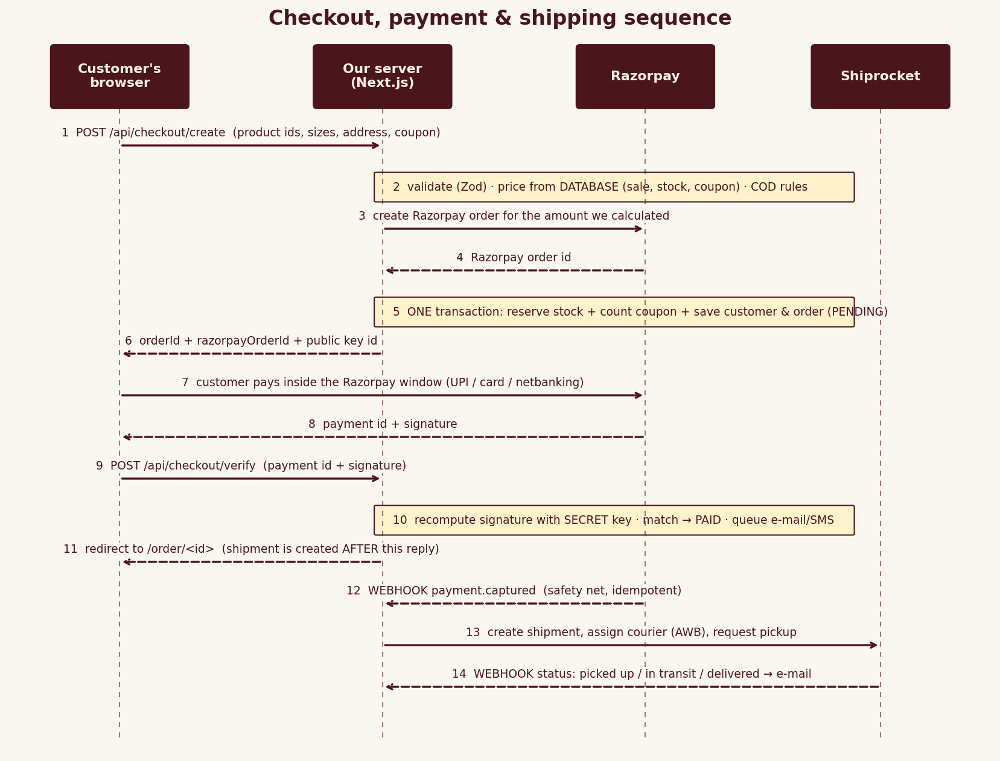

# Internal 06 · Troubleshooting – Payments & Refunds

| | |
|---|---|
| **Audience** | INTERNAL – support & developers |
| **Use when** | a customer says "I paid but…", "payment failed", "refund not received", or the owner sees mismatches |

## 1 · How a payment travels (so you know where to look)

Evidence exists in **four** places – always check them in this order:
| # | Where | How | What it proves |
|---|---|---|---|
| 1 | **Our order record** | Admin → order → *Event log*, or SQL below | what our system believes |
| 2 | **Our logs** | `pm2 logs …` | errors with request ids |
| 3 | **Razorpay dashboard** | Transactions → Payments (search payment id / order id / e-mail) | what the money did |
| 4 | **Razorpay webhook log** | Account & Settings → Webhooks → event log | whether Razorpay reached us and our answer code |

## 2 · Commands
| Purpose | Command | How to read it |
|---|---|---|
| Order + payment fields | `psql "$DATABASE_URL" -x -c "select id,status,payment_status,razorpay_order_id,razorpay_payment_id,failure_reason,total,refunded_amount from orders where id='LT…'"` | `payment_status` CAPTURED = we recorded the money |
| Order events | `psql "$DATABASE_URL" -c "select at,type,message from order_events where order_id='LT…' order by id"` | look for `PAYMENT_CAPTURED`, `PAYMENT_FAILED`, `LATE_PAYMENT`, `REFUND`, `REFUND_FAILED` |
| Webhook activity | `pm2 logs luxe-thread --lines 3000 --nostream \| grep -E "webhook.razorpay"` | `failed` + `INVALID_SIGNATURE` = wrong secret |
| Signature failures | `… \| grep INVALID_SIGNATURE` | |
| Provider rejections | `… \| grep -E "razorpay (order creation\|refund) rejected"` | log contains Razorpay's own reason |
| Paid in Razorpay but not in our DB | compare Razorpay *Captured* list with `select id,razorpay_payment_id from orders where payment_status='CAPTURED'` | any payment id missing in our DB needs **redelivery** (§4) |
| Orders stuck unpaid | `select id,created_at from orders where status='PENDING_PAYMENT' order by created_at` | older than 30 min should be `CANCELLED` (cron job); if not, run expiry job |
| Run expiry manually | `curl -X POST -H "x-jobs-secret: $JOBS_SECRET" https://host/api/jobs/expire-orders` | `{"expired":n}` |
| Validate API keys | `curl -s -o /dev/null -w "%{http_code}" -u "$RAZORPAY_KEY_ID:$RAZORPAY_KEY_SECRET" https://api.razorpay.com/v1/orders?count=1` | 200 ok / 401 wrong |
| Health | `curl -s https://host/api/health` | `razorpay:true` |

## 3 · Symptom → cause → fix
| Symptom | Likely cause | Fix |
|---|---|---|
| Payment window doesn't open | `checkout.razorpay.com` blocked (ad-blocker/firewall); CSP enforced without Razorpay domains | disable blocker; allow domains in CSP |
| "Online payment is not configured yet" (503) | key id/secret empty | set env, restart |
| "payment provider could not start this payment" (502) | wrong/expired key, test key + live account, Razorpay outage | check log line `razorpay order creation rejected` (`providerMessage`); §2 key check; Razorpay status page |
| "Sorry – X just sold out" at pay time | last piece bought by someone else between bag and pay | expected; customer picks another size |
| Customer paid, order **Awaiting payment** | verify call failed **and** webhook missing/failing | Razorpay webhook log → find the event → fix secret/URL → **Redeliver**; order flips to PAID |
| Order **Cancelled** but customer paid | paid after 30-min expiry | system records `LATE_PAYMENT` and **auto-refunds**; check `REFUND` event; if `REFUND_FAILED`, refund manually (§5) |
| `INVALID_SIGNATURE` on `/api/checkout/verify` | key id/secret from different modes | use matching pair |
| `INVALID_SIGNATURE` on webhook | webhook secret differs / proxy altered body | re-enter secret (both sides); Nginx must not modify body |
| Webhook "not reachable" | URL not public/HTTPS, firewall | fix DNS/443; for local use tunnel |
| Payment stays "authorized" then refunded by Razorpay | capture mode manual | set automatic capture |
| Same payment twice in events | verify + webhook both arrived | harmless (idempotent) |
| Two payments for one order | customer retried after a failed attempt and both captured | refund the extra one in Razorpay dashboard |
| Amount differs from the page | price/sale changed after order creation | orders keep price at purchase time |
| Failed payment then success | normal retry | `PAYMENT_FAILED → PAID` is allowed |

## 4 · Recovering a paid-but-unrecorded payment
1. Razorpay dashboard → payment → copy **order id** (`order_…`) and **payment id**.
2. Webhooks → event log → open the `payment.captured` event → **Redeliver**. Expect 200.
3. If the log shows `INVALID_SIGNATURE`: fix `RAZORPAY_WEBHOOK_SECRET`, restart, redeliver.
4. If redelivery is impossible: `curl` §2 of the Config guide (5.2) is for tests only – **do not** forge production events. Instead mark in Admin by creating the shipment only after confirming the capture in Razorpay, and ask the developer to confirm the payment via SQL in a transaction (`update orders set payment_status='CAPTURED', status='PAID', razorpay_payment_id='pay_…'`) plus an `order_events` row `MANUAL_FIX`.
5. Verify: order shows PAID, customer received confirmation (Admin → Messages).

## 5 · Refund problems
| Symptom | Cause | Fix |
|---|---|---|
| Admin refund error "no online payment to refund" | order is COD, unpaid, or already fully refunded | check `payment_status` |
| "Refund must be between ₹1 and ₹…" | more than remaining | enter ≤ remaining |
| `REFUND_FAILED` event | Razorpay rejected (insufficient balance in settlement account, payment too old, already refunded) | read the message; Razorpay dashboard → Payments → refund manually; add a note; retry later |
| Customer: "no refund yet" | refunds take 5–7 business days to reach bank | show them refund id from Razorpay (`rfnd_…`) |
| Refund created in dashboard manually | our DB doesn't know | add event / update `refunded_amount` (ask developer) |
Check refunds: `select amount,status,razorpay_refund_id,reason from refunds where order_id='LT…'`.

## 6 · Daily reconciliation (5 minutes)
1. Razorpay → Payments (yesterday, *Captured*) → count N and ₹ total T.
2. `select count(*), sum(total) from orders where payment_method='PREPAID' and payment_status in ('CAPTURED','PARTIALLY_REFUNDED','REFUNDED') and created_at::date = '<date>'`.
3. N and T should match (ignore timezone edge: compare in IST). Differences → §4.
