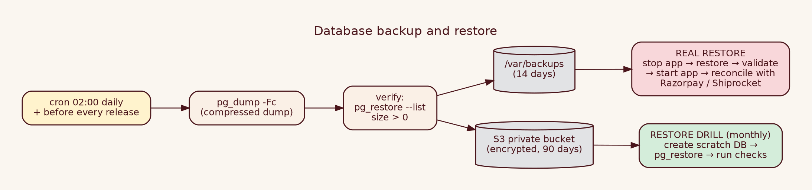

# Internal 10 · Database Backup & Restore

| | |
|---|---|
| **Audience** | INTERNAL – DevOps / developers |
| **Protects** | PostgreSQL data (orders, stock, customers) **and** uploaded photos (`UPLOAD_DIR`) |
| **Targets** | **RPO** (max data loss) ≤ 24 h (≤ 6 h during sales) · **RTO** (time to recover) ≤ 2 h |



## 1 · What to back up
| Item | How | Frequency | Keep |
|---|---|---|---|
| Database | `pg_dump -Fc` (compressed custom format) | daily 02:00 + before each release (+ every 6 h in sale season) | 14 days local, 90 days S3 |
| Photos | copy `UPLOAD_DIR` (rsync/aws s3 sync) | daily | same |
| Secrets file | `.env.production.local` stored in your **password manager** | on change | – |
| Code | Git | – | – |

## 2 · Manual backup
```bash
mkdir -p /var/backups/luxe-thread && cd /var/backups/luxe-thread
STAMP=$(date +%F-%H%M)
pg_dump "$DATABASE_URL" -Fc -f luxe-$STAMP.dump          # -Fc = compressed archive that pg_restore understands
pg_restore --list luxe-$STAMP.dump | head                  # proves the file is a valid archive (must print table entries)
ls -lh luxe-$STAMP.dump                                    # size must be > 0 and plausible
tar -czf uploads-$STAMP.tgz -C "$(dirname $UPLOAD_DIR)" "$(basename $UPLOAD_DIR)"   # photos
```

## 3 · Automatic backup (schedule)
`/usr/local/bin/luxe-backup.sh` (`sudo chmod 750`):
```bash
#!/bin/bash
set -euo pipefail
source /home/ubuntu/fashion-store/.env.production.local          # provides DATABASE_URL, UPLOAD_DIR
DIR=/var/backups/luxe-thread; STAMP=$(date +%F-%H%M); mkdir -p "$DIR"
pg_dump "$DATABASE_URL" -Fc -f "$DIR/luxe-$STAMP.dump"
pg_restore --list "$DIR/luxe-$STAMP.dump" > /dev/null             # fails the script if the dump is corrupt
tar -czf "$DIR/uploads-$STAMP.tgz" -C "$(dirname "$UPLOAD_DIR")" "$(basename "$UPLOAD_DIR")"
aws s3 cp "$DIR/luxe-$STAMP.dump"   s3://YOUR-PRIVATE-BUCKET/db/      --sse AES256
aws s3 cp "$DIR/uploads-$STAMP.tgz" s3://YOUR-PRIVATE-BUCKET/uploads/ --sse AES256
find "$DIR" -type f -mtime +14 -delete                            # keep 14 days locally
echo "$(date -Is) backup ok $STAMP" >> /var/log/luxe-backup.log
```
Schedule: `sudo crontab -e` →
```
0 2 * * *  /usr/local/bin/luxe-backup.sh || echo "BACKUP FAILED" | mail -s "luxe backup failed" you@your-domain.in
```
*(Use `rclone` instead of `aws` for any other storage. Give the server an IAM role with **write-only** access to the bucket and enable bucket versioning.)*

**Check it runs:** `tail /var/log/luxe-backup.log` (a line per day) and the daily HC list.

## 4 · Restore procedures

### 4.1 Restore drill (do monthly, on a scratch database – safe)
```bash
createdb luxe_restore_test                                         # empty scratch database
pg_restore --no-owner --dbname=luxe_restore_test luxe-<stamp>.dump   # load the backup
psql luxe_restore_test -c "select count(*) from orders"            # compare with production count
dropdb luxe_restore_test                                           # clean up
```
### 4.2 Real restore (disaster) – production
1. **Announce** downtime; put up maintenance (Nginx `return 503`) or `pm2 stop luxe-thread`.
2. **Keep the broken DB** for forensics: `psql -c "alter database luxe_thread rename to luxe_thread_broken_$(date +%F)"` (or dump it first).
3. Create a fresh DB and restore:
```bash
createdb luxe_thread
pg_restore --no-owner --clean --if-exists --dbname=luxe_thread luxe-<stamp>.dump
```
4. Restore photos if lost: `tar -xzf uploads-<stamp>.tgz -C /var/lib/luxe-thread/`.
5. Ensure `DATABASE_URL` points to the restored DB; `npm run db:migrate` (applies any newer migrations).
6. `pm2 start luxe-thread`; run **validation** (§5).
7. **Reconcile the gap** (orders between the backup time and the failure): Razorpay → Payments list; Shiprocket → Orders; compare with the restored DB. Re-deliver Razorpay webhooks for missing payments (Payments guide §4). Re-create shipments for paid orders without `shiprocket_order_id`.
8. Tell the owner the data window that was recovered.

## 5 · What to validate after any restore
| # | Check | Query / action | Expected |
|---|---|---|---|
| 1 | Tables exist | `\dt` | all tables incl. `schema_migrations` |
| 2 | Row counts sensible | `select (select count(*) from products) p,(select count(*) from orders) o,(select count(*) from customers) c` | ≈ production numbers |
| 3 | Latest order time | `select max(created_at) from orders` | close to backup time |
| 4 | Stock integrity | stock = sum of movements query (Database doc §7) | **no rows** |
| 5 | No negative stock | `select count(*) from product_variants where stock<0` | 0 (the CHECK rule prevents it) |
| 6 | Admin login | sign in | works (admin users restored) |
| 7 | Health | `/api/health` | `database:true` |
| 8 | A product page with photos | open | photo loads |
| 9 | Payment reconciliation | Payments guide §6 for the gap day(s) | matches |
| 10 | Outbox | `select status,count(*) from notifications group by 1` | no huge `queued` backlog sending old news (see 5a) |
| 11 | Sequences | `select last_value from stock_movements_id_seq` ≥ max(id) | ok (restore handles) |
**5a.** After restore, old queued messages could be re-sent. Check `select count(*) from notifications where status='queued'`; if the messages are stale: `update notifications set status='skipped', last_error='skipped after restore' where status='queued' and created_at < now()-interval '1 day'`.

## 6 · Common problems
| Symptom | Cause | Fix |
|---|---|---|
| `pg_dump: server version mismatch` | client older than server | install matching `postgresql-client-16` |
| `permission denied` | wrong user | run as a role with access; check `.pgpass` |
| Backup file tiny | dump failed silently | the script's `pg_restore --list` + `set -e` catches; read the log |
| Restore error "already exists" | restoring into a non-empty DB | use `--clean --if-exists` or a new DB |
| S3 upload denied | IAM role | give `s3:PutObject` on the bucket |
| Disk full during dump | `/var/backups` on small disk | prune; mount bigger volume |

## 7 · Customer-friendly summary
"Every night at 2 a.m. we save a compressed copy of your shop data and photos to a private encrypted cloud bucket, keep 14 days on the server and 90 days in the cloud, and every month we practise restoring it to prove it works."
