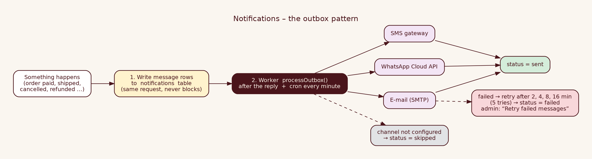

# Internal 12 · Notifications & Customer Marketing Design

| | |
|---|---|
| **Audience** | INTERNAL – developers |
| **Covers** | E-mail, SMS, WhatsApp (optional), consent, campaigns, retries |

## 1 · Design in one paragraph
Messages are first **written to a table** (`notifications`), then a worker sends them. A slow SMTP server can never slow or break checkout; failures retry automatically; nothing is lost. Each channel is optional: if it is not configured the message becomes `skipped`, not an error.

## 2 · Which events send what
| Event | Template | Channels |
|---|---|---|
| Order placed & paid / COD confirmed | `order_confirmed` | e-mail · SMS* · WhatsApp** |
| Payment failed | `payment_failed` *(ready; wire when needed)* | e-mail |
| Handed to courier (SHIPPED) | `order_shipped` (courier, tracking link) | e-mail · SMS* · WhatsApp** |
| Delivered | `order_delivered` | same |
| Cancelled | `order_cancelled` (+ refund note) | same |
| Refund processed | `refund_processed` | same |
| Return approved / rejected | `return_update` | same |
| Offers / new arrivals | `marketing` | only the channel the customer **opted in** to |
\* if `SMS_ENABLED` · \*\* if `WHATSAPP_ENABLED` **and** the customer ticked WhatsApp.

## 3 · Channels, providers, India rules
| Channel | How it is sent | Open-source / alternatives | India-specific rules |
|---|---|---|---|
| **E-mail** | Nodemailer → any SMTP | Postfix, Mailu, Mailcow (self-host); or provider SMTP (Amazon SES, Brevo, Zoho) | SPF + DKIM + DMARC on your domain; unsubscribe link in marketing |
| **SMS** | HTTP POST to your gateway (`SMS_GATEWAY_URL`) JSON `{to,message,sender}` | gateways: MSG91, Fast2SMS, Kaleyra… (self-host Kannel/Gammu needs a GSM modem + operator DLT) | **TRAI DLT registration** of your *entity, sender ID (header) and each message template* is mandatory; the text must match the approved template; promotional SMS need consent and timing rules. Adjust `sendSms` payload to your gateway's API |
| **WhatsApp** | Meta WhatsApp Business **Cloud API**, template messages | Official API is free to set up, conversation pricing applies; open-source gateways (Evolution API, WAHA) are **unofficial** and risk number bans – not recommended for a business | Templates must be **pre-approved** by Meta; customer must opt in; template names = our names (`order_confirmed`…) with body variables `{{1}}` first name, `{{2}}` order id |

### Suggested approved texts (copy to your DLT / Meta console and adjust)
* `order_confirmed`: "Hi {{1}}, your Luxe & Thread order {{2}} is confirmed. Track it: {{3}}"
* `order_shipped`: "Hi {{1}}, order {{2}} is on its way via {{3}}. Tracking: {{4}}"
* `order_cancelled`: "Hi {{1}}, order {{2}} is cancelled. Any payment will be refunded in 5–7 days."
(The code sends `params: [first name, order id]` for WhatsApp; extend `notifyOrder` if you add more variables.)

## 4 · Consent (DPDP Act 2023 / TRAI)
* Checkout has **three separate, un-ticked** boxes (e-mail, SMS, WhatsApp). Order updates are *transactional* and always sent by e-mail.
* Consent flags are only ever switched **on** by an explicit tick; **off** by the unsubscribe link (`/unsubscribe?t=<token>` → confirm button → all marketing consent off).
* `consent_updated_at` records when consent last changed. Keep the Privacy Policy accurate.
* Marketing never goes to customers without the flag; `queueCampaign` filters `*_opt_in = true`.

## 5 · Campaign procedure (owner)
Admin → Customers → *Send offers* → name, channel, subject, message → **Queue campaign**. The counts of eligible customers are shown first. Messages go out within ~1 minute (cron), personalised with "Hi <first name>,". Check Admin → Messages.

## 6 · Worker details
`processOutbox(limit)`: `UPDATE … WHERE id IN (SELECT … FOR UPDATE SKIP LOCKED) RETURNING` claims rows (attempts+1, `next_attempt_at = now+10 min` as a lease) → send → `sent` | `skipped` | on error `markFailed(retry in 2^attempts min)`; after 5 attempts `failed`. Triggered by `after()` on order events and by cron `/api/jobs/notifications` every minute.

## 7 · Operating & monitoring
`/api/health` → `notificationQueue` counts; Admin → Messages (last error per row); alert if `failed > 0` or `queued` grows. Purge old rows monthly (Database doc §8).

## 8 · Extending
New event → add a template in `templates.ts`, call `notifyOrder(order, 'name')` at the service step, add a unit test. New channel → add a provider in `providers.ts` and a case in `deliver()`.
