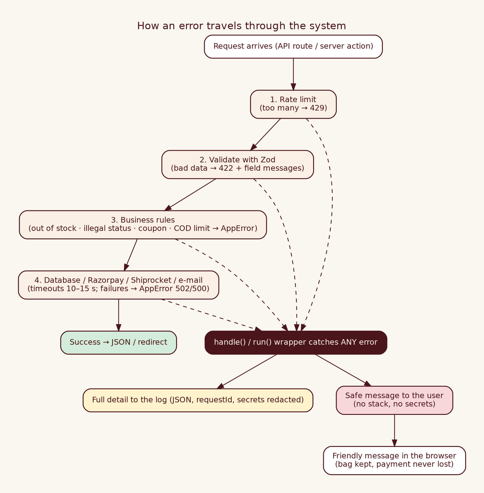

# Internal 16 · Error Handling

| | |
|---|---|
| **Audience** | INTERNAL – developers |



## 1 · Principles
1. **Validate at the door** (Zod → 422 with per-field messages). 2. **One error type** `AppError(code, message, status)`. 3. **One catch-all wrapper**: API routes use `handle()`, admin actions use `run()`; both log full detail and return a safe message. 4. **Customers see friendly text; logs hold the truth.** 5. **Never lose a payment.** 6. **Everything repeatable is idempotent.**

## 2 · Standard error response
```json
{ "error": { "code": "VALIDATION_ERROR", "message": "Only 2 left of Kasavu Set (M).", "details": { "code": "INSUFFICIENT_STOCK", "available": 2 }, "requestId": "5b1c…" } }
```
Quote `requestId` → `grep` it in the logs.

## 3 · Codes
| Code | HTTP | Meaning | Typical cause / action |
|---|---|---|---|
| `VALIDATION_ERROR` | 400/409/422 | bad input or business rule | read message (stock, coupon, COD limit, PIN) |
| `NOT_FOUND` | 404 | order/product/link token wrong | |
| `UNAUTHORIZED` | 401 | wrong webhook/job token | check secrets |
| `RATE_LIMITED` | 429 | too many requests | wait |
| `INVALID_STATE` | 409 | action not allowed in this status | e.g. ship an unpaid order |
| `INVALID_SIGNATURE` | 400 | payment/webhook signature mismatch | key/secret mix-up |
| `CONFIG_MISSING` | 503 | env value missing | fill env |
| `PAYMENT_PROVIDER_ERROR` | 502 | Razorpay down/rejected | see logs `providerMessage` |
| `SHIPPING_PROVIDER_ERROR` | 502 | Shiprocket down/rejected | API user, wallet, pickup name |
| `STORAGE_ERROR` | 500 | database error (`sqlState` in details) | [Troubleshooting §4](Internal_05_Troubleshooting_Application.md) |
| `INTERNAL_ERROR` | 500 | unexpected | stack trace in log |

## 4 · Admin actions
`run(path, okMessage, fn)` redirects back with `?ok=` (green) or `?err=` (red). Known `AppError`s show their message; unknown errors show "See the server log". Redirect "errors" (`NEXT_REDIRECT`) are re-thrown so navigation works.

## 5 · Scenario table
| Scenario | Behaviour |
|---|---|
| Last piece bought elsewhere | order transaction rolls back; "just sold out" |
| Razorpay down at checkout | nothing saved or reserved; "please try again" |
| Browser closes after paying | webhook marks PAID; order link works |
| verify fails after paying | no error shown; order page auto-refreshes until PAID |
| Duplicate webhooks | idempotent |
| Payment after cancellation | auto-refund |
| Shiprocket down | order stays PAID; error saved; retry button |
| Courier cancel fails | order unchanged; `CANCEL_BLOCKED`; customer told |
| SMTP down | outbox retries 5× with back-off; then `failed` + admin retry |
| Corrupt browser bag | sanitised; server re-prices |
| DB down | shop shows "could not load"; `/api/health` 503 |
| Page crash | `error.tsx` friendly page; `global-error.tsx` last resort |
| Disk/permission error on photo upload | red message; photo not attached |

## 5b · Logging
One JSON line per event with `level`, `message`, `requestId`, `code`, `status`; secrets redacted. Read with `pm2 logs`. Levels: info/warn/error.

## 6 · Adding error handling to new code
Validate with Zod · throw `AppError` for expected failures · wrap routes in `handle()` · timeouts on every outside call · make it idempotent · add a unit test.
